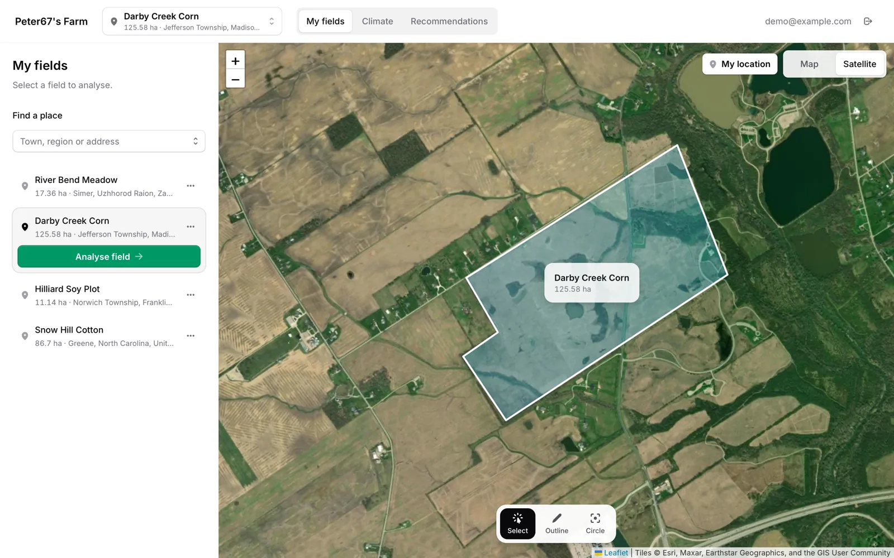
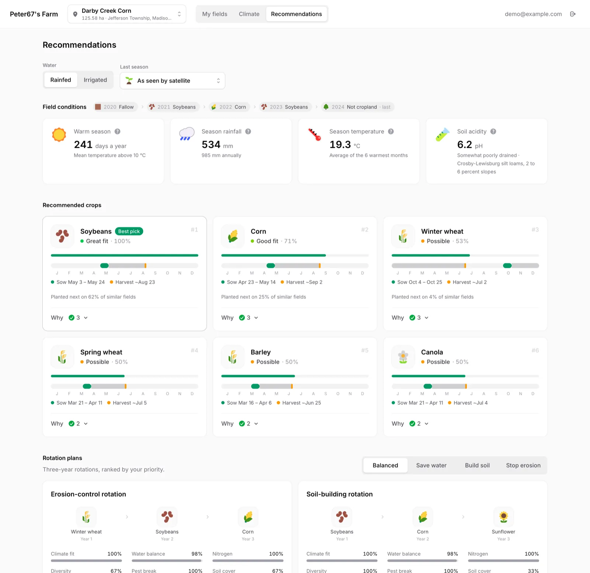
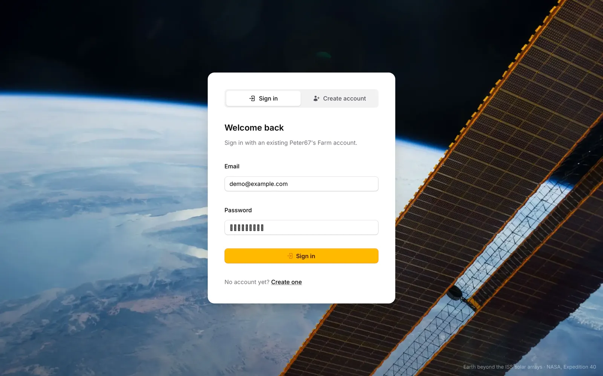

# Peter67's Farm

**Outline your field on a satellite map and find out what to plant there.**

👉 **[farm.peter67.nasa.kpi.yaroslavyushchenko.com](https://farm.peter67.nasa.kpi.yaroslavyushchenko.com/)**

Try it with the demo account: `demo@example.com` / `123456789` (it is filled in on the sign-in page).



## What it does

- **Draw your field.** Find your land by search or your location, then click around its edges on the satellite map, or mark it as a circle.
- **See what grew there.** For US fields the app reads past seasons from satellite crop records, so you see what was planted in recent years.
- **Get crop recommendations.** Crops are ranked for your field's climate, rainfall and soil, with sowing and harvest windows.
- **Plan rotations.** Three-year rotation plans, ranked by what matters to you: saving water, building soil or stopping erosion.

Climate data comes from NASA POWER, past crops from USDA CropScape and soil from USDA SSURGO.



<p align="center">
  
</p>

## Run it locally

You need .NET SDK 10, Node 22+, Docker and [uv](https://docs.astral.sh/uv/).

```bash
cd Frontend && npm install && cd ..
dotnet run --project Backend/src/AppHost
```

The Aspire dashboard opens with a link to the app. The local database starts with the same demo account.
